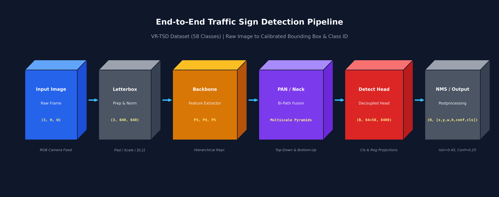
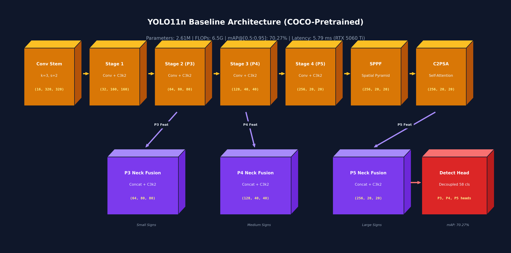
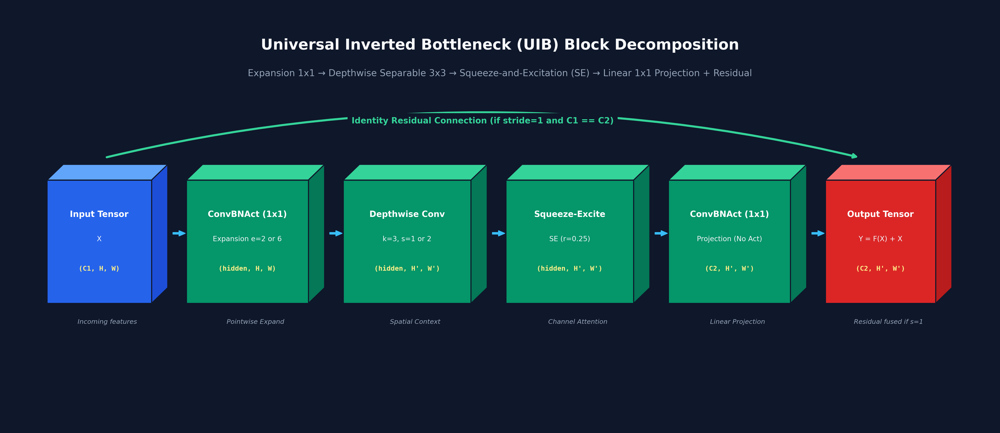
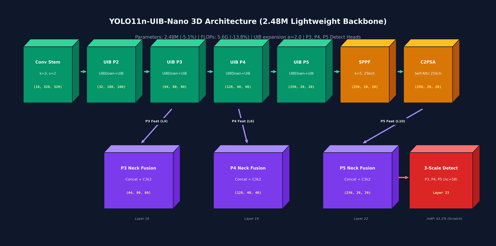
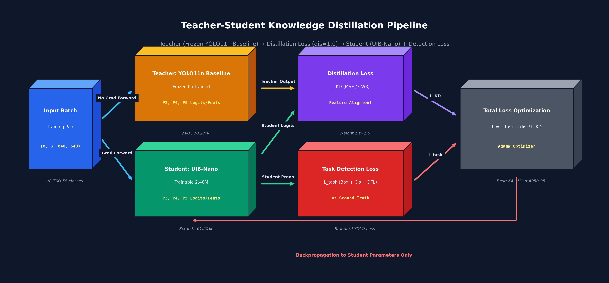
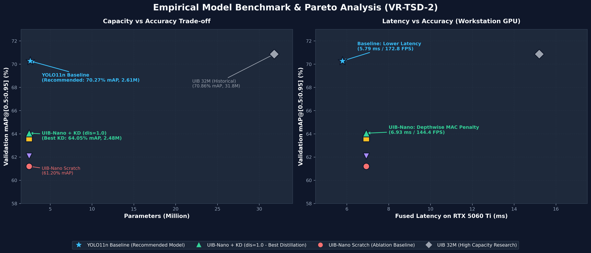
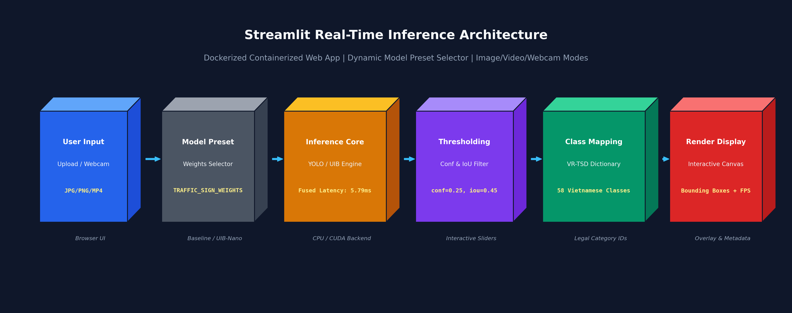

# Trafic: Vietnamese Traffic Sign Detection & Empirical Architecture Benchmark

[](https://www.python.org/)
[](https://pytorch.org/)
[](https://github.com/ultralytics/ultralytics)
[](https://www.docker.com/)
[](https://streamlit.io/)
[](LICENSE)

An empirical research and engineering benchmark investigating the integration of **Universal Inverted Bottleneck (UIB)** building blocks into the **Ultralytics YOLO11** framework for Vietnamese traffic sign localization and classification (VR-TSD-2, 58 legal categories). Includes teacher-student **Knowledge Distillation**, controlled trade-off profiling, and an interactive **Dockerized Streamlit** deployment application.

---

## Table of Contents
- [1. Project Overview & Motivation](#1-project-overview--motivation)
- [2. System Pipeline Architecture](#2-system-pipeline-architecture)
- [3. Model Architectures](#3-model-architectures)
  - [3.1. YOLO11n Baseline Architecture](#31-yolo11n-baseline-architecture)
  - [3.2. Universal Inverted Bottleneck (UIB) Block Decomposition](#32-universal-inverted-bottleneck-uib-block-decomposition)
  - [3.3. YOLO11n-UIB-Nano Lightweight Architecture](#33-yolo11n-uib-nano-lightweight-architecture)
  - [3.4. YOLO11n-UIB High-Capacity (32M) Architecture](#34-yolo11n-uib-high-capacity-32m-architecture)
- [4. Knowledge Distillation Pipeline](#4-knowledge-distillation-pipeline)
- [5. Controlled Benchmark Methodology](#5-controlled-benchmark-methodology)
- [6. Full Benchmark Results & Trade-Off Analysis](#6-full-benchmark-results--trade-off-analysis)
  - [6.1. Comprehensive Evaluation Table](#61-comprehensive-evaluation-table)
  - [6.2. Capacity vs. Accuracy & Latency Trade-Off Analysis](#62-capacity-vs-accuracy--latency-trade-off-analysis)
- [7. Interactive Streamlit Demo](#7-interactive-streamlit-demo)
- [8. Containerized Docker Deployment](#8-containerized-docker-deployment)
- [9. Repository Structure](#9-repository-structure)
- [10. Reproducibility Guide](#10-reproducibility-guide)
- [11. Technical Limitations & Engineering Integrity](#11-technical-limitations--engineering-integrity)
- [12. License](#12-license)

---

## 1. Project Overview & Motivation

Autonomous driving assistance and traffic surveillance systems in Vietnam face acute real-world challenges governed by national standard **QCVN 41:2019/BGTVT**:
- **Sign Variety & Visual Density:** Over 58 standard sign classes spanning regulatory, prohibitive, warning, and informational categories.
- **Urban Background Clutter:** Frequent occlusions by vegetation, utility wiring, commercial billboards, and high-density two-wheeler traffic.
- **Severe Scale Variance:** Traffic signs appear at tiny visual scales (often under $24 \times 24$ pixels) relative to standard camera frames, demanding fine spatial resolution.

### Research Objective
This project systematically investigates whether replacing standard standard convolutional / C3k2 stages in YOLO11n with **Universal Inverted Bottleneck (UIB)** blocks (combining depthwise separable convolutions, inverted expansion, and Squeeze-and-Excitation attention) improves the parameter and FLOP efficiency profile under realistic training constraints. 

All claims are validated through a pre-registered matched-recipe protocol, comparing COCO-pretrained YOLO11n against custom UIB architectures trained from scratch and distilled via teacher-student optimization.

---

## 2. System Pipeline Architecture

The end-to-end detection pipeline processes high-resolution video streams and camera feeds through aspect-ratio-preserving letterboxing, multi-scale hierarchical feature extraction, cross-scale path aggregation, decoupled anchor-free detection heads, and Non-Maximum Suppression (NMS).

<div align="center">
  
  <p><em>Figure 1: End-to-end Vietnamese traffic sign detection pipeline from raw camera input to calibrated bounding boxes and legal class identities.</em></p>
</div>

1. **Preprocessing / Letterbox:** Rescales input frames to $640 \times 640$ pixels with symmetric edge padding to prevent aspect-ratio distortion of directional signs.
2. **Backbone:** Hierarchically downsamples representations across P1–P5 spatial scales (strides 2 to 32).
3. **PAN / Neck:** Aggregates multi-scale semantic and localization signals using bidirectional top-down and bottom-up pathways.
4. **Decoupled Detect Head:** Projects unified features into separate bounding box regression (DFL) and 58-class classification logits across P3, P4, and P5.
5. **NMS Postprocessing:** Suppresses duplicate overlapping candidate boxes using IoU thresholding ($\text{IoU}=0.45, \text{conf}=0.25$).

---

## 3. Model Architectures

### 3.1. YOLO11n Baseline Architecture
The baseline detector is based on the Ultralytics YOLO11n architecture, initialized from COCO pretraining weights and fine-tuned on the VR-TSD-2 dataset.

<div align="center">
  
  <p><em>Figure 2: YOLO11n baseline 3D volumetric tensor block architecture with multi-scale P3/P4/P5 detection heads.</em></p>
</div>

- **Parameters:** 2,610,902 (2.61M)
- **Computational Cost:** 6.5 GFLOPs ($640 \times 640$ input)
- **Backbone:** Convolutional stem followed by 4 stages of C3k2 blocks, SPPF (Spatial Pyramid Pooling - Fast), and C2PSA (Cross Stage Partial with Pointwise Self-Attention).
- **Neck:** Bidirectional Path Aggregation Network (PANet) fusing P3 ($80 \times 80$), P4 ($40 \times 40$), and P5 ($20 \times 20$) feature representations.

---

### 3.2. Universal Inverted Bottleneck (UIB) Block Decomposition
The **UIB** module combines the depthwise efficiency of MobileNetV4 with explicit channel-reweighting attention:

<div align="center">
  
  <p><em>Figure 3: Volumetric decomposition of the Universal Inverted Bottleneck (UIB) block.</em></p>
</div>

Mathematically, for an input tensor $X \in \mathbb{R}^{C_1 \times H \times W}$:
1. **Pointwise Expansion:** $X_{\text{exp}} = \text{SiLU}(\text{BN}(\text{Conv}_{1 \times 1}(X))) \in \mathbb{R}^{C_{\text{hidden}} \times H \times W}$ where $C_{\text{hidden}} = \text{round}(C_1 \times e)$.
2. **Depthwise Convolution:** $X_{\text{dw}} = \text{SiLU}(\text{BN}(\text{DWConv}_{3 \times 3, s}(X_{\text{exp}}))) \in \mathbb{R}^{C_{\text{hidden}} \times H' \times W'}$.
3. **Squeeze-and-Excitation (SE):** Computes channel-wise attention coefficients:
   $$\mathbf{w} = \sigma\left(\mathbf{W}_2 \cdot \text{SiLU}\left(\mathbf{W}_1 \cdot \text{AdaptiveAvgPool}(X_{\text{dw}})\right)\right), \quad X_{\text{se}} = X_{\text{dw}} \odot \mathbf{w}$$
4. **Linear Pointwise Projection:** $Y_{\text{proj}} = \text{BN}(\text{Conv}_{1 \times 1}(X_{\text{se}})) \in \mathbb{R}^{C_2 \times H' \times W'}$.
5. **Residual Shortcut:** If stride $s = 1$ and $C_1 = C_2$, the final output is $Y = X + Y_{\text{proj}}$; otherwise, $Y = Y_{\text{proj}}$.

---

### 3.3. YOLO11n-UIB-Nano Lightweight Architecture
To create an ultra-compact detector strictly lighter than the Baseline, **UIB-Nano** constrains the channel expansion factor to $e=2.0$ while preserving standard P3–P5 detection heads:

<div align="center">
  
  <p><em>Figure 4: YOLO11n-UIB-Nano 3D volumetric architecture with verified tensor dimensions from YAML specification.</em></p>
</div>

- **Parameters:** 2,476,566 fused (2.48M) — **5.14% reduction** vs Baseline.
- **Computational Workload:** 5.6 GFLOPs — **13.85% reduction** vs Baseline.
- **Tensor Dimensional Verification:**
  - Layer 0: Conv Stem $[16, 3, 2] \rightarrow 16 \times 320 \times 320$
  - Layers 1–2: UIBDown + UIB $[32, 3, 2, 2.0] \rightarrow 32 \times 160 \times 160$ (P2)
  - Layers 3–4: UIBDown + UIB $[64, 3, 2, 2.0] \rightarrow 64 \times 80 \times 80$ (P3)
  - Layers 5–6: UIBDown + UIB $[128, 3, 2, 2.0] \rightarrow 128 \times 40 \times 40$ (P4)
  - Layers 7–8: UIBDown + UIB $[256, 3, 2, 2.0] \rightarrow 256 \times 20 \times 20$ (P5)
  - Layer 9: SPPF $[256, 5] \rightarrow 256 \times 20 \times 20$
  - Layer 10: C2PSA $[256] \rightarrow 256 \times 20 \times 20$

---

### 3.4. YOLO11n-UIB High-Capacity (32M) Architecture
An unconstrained research variant (`configs/models/yolo11n_uib_backbone.yaml`) featuring deep UIB stages with $e=6.0$ expansion up to 512 channels and a 4-level detection head (P2, P3, P4, P5):
- **Parameters:** 31.78M (~12.2x Baseline)
- **Computational Cost:** 51.9 GFLOPs (~8.0x Baseline)
- **Role:** Serves as an architectural capacity ceiling to test whether deep UIB blocks can attain high mAP when parameter constraints are completely relaxed.

---

## 4. Knowledge Distillation Pipeline

Because UIB-Nano lacks large-scale COCO pretraining, we established a controlled teacher-student Knowledge Distillation pipeline using the COCO-pretrained YOLO11n Baseline as a fixed teacher:

<div align="center">
  
  <p><em>Figure 5: Teacher-student Knowledge Distillation training flow with dual loss formulation and gradient isolation.</em></p>
</div>

### Objective Formulation
The student is trained using a composite objective:
$$\mathcal{L}_{\text{total}} = \mathcal{L}_{\text{task}}(Y_{\text{student}}, Y_{\text{gt}}) + \lambda_{\text{dis}} \cdot \mathcal{L}_{\text{KD}}(F_{\text{student}}, F_{\text{teacher}})$$
where:
- $\mathcal{L}_{\text{task}}$ combines Complete IoU (CIoU), Distribution Focal Loss (DFL), and Binary Cross-Entropy (BCE) classification loss against ground-truth labels.
- $\mathcal{L}_{\text{KD}}$ aligns multi-scale feature pyramids across P3, P4, and P5 detection outputs.
- $\lambda_{\text{dis}} \in \{0.5, 1.0, 2.0\}$ is systematically ablated across a pre-registered grid under seed 42.

---

## 5. Controlled Benchmark Methodology

To ensure scientific reproducibility and eliminate confounding variables, all models were trained and benchmarked under an identical, standardized protocol:

| Dimension | Specification |
| :--- | :--- |
| **Dataset** | Vietnamese Real-world Traffic Sign Dataset v2 (`VR-TSD-2`) |
| **Class Count** | 58 fine-grained sign categories |
| **Split Partition** | 5,668 train (70%) / 1,259 validation (15%) / 1,151 test (15%) |
| **Resolution** | $640 \times 640$ pixels |
| **Training Budget** | 200 epochs, batch size 8 |
| **Optimizer** | AdamW (`lr0=0.001`, `lrf=0.01`, `weight_decay=0.0005`, `momentum=0.937`) |
| **LR Schedule** | Cosine Annealing with 3.0 warmup epochs |
| **Augmentation** | Mosaic ($1.0$), Mixup ($0.05$), Close Mosaic at epoch 180 (final 20 epochs); **No horizontal flip** (`fliplr=0.0`) to preserve directional sign semantics |
| **Hardware** | Workstation equipped with NVIDIA GeForce RTX 5060 Ti (16GB VRAM, CUDA 12.8) |
| **Profiling Method** | Hardware-synchronized `torch.cuda.Event` over 500 iterations after 50 warmup iterations |
| **Checkpoint Policy** | Strictly chosen at the peak validation mAP@[0.5:0.95] epoch |

All hyperparameter hashes and exact metric artifacts are cataloged in [`configs/benchmark_recipe_manifest.json`](configs/benchmark_recipe_manifest.json).

---

## 6. Full Benchmark Results & Trade-Off Analysis

### 6.1. Comprehensive Evaluation Table

All measurements were conducted on the identical VR-TSD-2 validation split on the same physical RTX 5060 Ti workstation:

| Model Configuration | Training Paradigm | Fused Params | FLOPs (640x640) | Mean Latency (RTX 5060 Ti) | Throughput (FPS) | mAP@[0.5:0.95] | mAP@0.5 | Precision | Recall | Val Box Loss | Status / Role |
| :--- | :--- | :---: | :---: | :---: | :---: | :---: | :---: | :---: | :---: | :---: | :--- |
| **YOLO11n Baseline** | COCO-Pretrained | 2.61M | 6.5 G | **5.79 ms** | **172.8** | **70.27%** | **87.63%** | **92.19%** | **81.44%** | **0.832** | **Recommended Model** |
| **UIB 32M (Original)** | Scratch (P2–P5) | 31.78M | 51.9 G | 15.20 ms | 60.9 | **70.86%** | 86.80% | 89.39% | **82.51%** | **0.787** | Research Ablation (Capacity) |
| **UIB-Nano (Scratch)** | Scratch (P3–P5) | **2.48M** | **5.6 G** | 6.93 ms | 144.4 | 61.20% | **83.71%** | 89.65% | 77.72% | 1.028 | Research Ablation (Scratch) |
| **UIB-Nano + KD ($\text{dis}=0.5$)** | Distillation | **2.48M** | **5.6 G** | 6.93 ms | 144.4 | 63.59% | 81.85% | 89.71% | 77.09% | 0.922 | Research Grid Point ($\text{dis}=0.5$) |
| **UIB-Nano + KD ($\text{dis}=1.0$)** | Distillation | **2.48M** | **5.6 G** | 6.93 ms | 144.4 | **64.05%** | 82.52% | 87.87% | 77.06% | **0.917** | **Best Distillation Candidate** |
| **UIB-Nano + KD ($\text{dis}=2.0$)** | Distillation | **2.48M** | **5.6 G** | 6.93 ms | 144.4 | 62.08% | 79.85% | 82.08% | 75.95% | 0.948 | Research Grid Point ($\text{dis}=2.0$) |

---

### 6.2. Capacity vs. Accuracy & Latency Trade-Off Analysis

<div align="center">
  
  <p><em>Figure 6: Controlled trade-off analysis: Parameters vs. Accuracy (left) and Workstation GPU Latency vs. Accuracy (right).</em></p>
</div>

### Critical Findings:
1. **The Pretraining Gap Dominates:** In the ultra-compact regime (~2.5M parameters), pretraining on 118k COCO images provides strong representational priors. Training UIB-Nano from scratch on ~5.6k domain images achieves 61.20% mAP. Distillation recovers **+2.85 points** (64.05% at $\text{dis}=1.0$), but a **6.22-point gap** remains relative to the Baseline.
2. **Depthwise FLOPs vs. GPU Memory Access Cost (MAC):** UIB-Nano reduces FLOPs by 13.85%, yet exhibits 19.7% higher latency on the RTX 5060 Ti (6.93 ms vs 5.79 ms). Depthwise convolutions have lower arithmetic intensity and fragment GPU streaming multiprocessor pipelines compared to standard dense convolutions.
3. **Non-Monotonic Distillation Grid Response:** Testing $\lambda_{\text{dis}} \in \{0.5, 1.0, 2.0\}$ revealed a distinct response peak:
   - $\text{dis}=0.5$: Provides light guidance; student retains high precision (89.71%) but achieves lower overall mAP (63.59%).
   - $\text{dis}=1.0$: Yields optimal balance; achieves peak validation mAP (64.05%) and lowest validation box loss (0.917).
   - $\text{dis}=2.0$: Over-constrains student features with teacher soft targets, degrading mAP (62.08%) and precision (82.08%).
4. **Pareto Dominance of YOLO11n Baseline:** For workstation and standard server deployments, YOLO11n Baseline strictly dominates UIB-Nano by delivering **higher accuracy (70.27% vs 64.05%)**, **higher FPS (172.8 vs 144.4)**, with only a negligible parameter difference (+0.13M).

---

## 7. Interactive Streamlit Demo

The repository includes a production-grade Streamlit web application supporting Image, Video, and Webcam inference.

<div align="center">
  
  <p><em>Figure 7: Interactive Streamlit runtime inference pipeline with dynamic preset switching and live metrics cards.</em></p>
</div>

### Demo Highlights:
- **Preset Model Selector:** Defaults automatically to the **Recommended Model** (`YOLO11n Baseline: 70.27% mAP, 5.79ms`), with options to select research ablation variants (`UIB-Nano KD`, `UIB 32M`, or custom paths).
- **Embedded Metrics Panel:** Renders live model metadata (Parameters, FLOPs, Validation mAP, and GPU Latency).
- **Graceful Error Handling:** If optional research checkpoints are missing, the UI displays an actionable warning without crashing.
- **Environment Variable Override:** Pass custom weights seamlessly via `TRAFFIC_SIGN_WEIGHTS`.

### Running Locally:
```bash
streamlit run app.py --server.port=8501 --server.address=0.0.0.0
```

---

## 8. Containerized Docker Deployment

A lightweight, production-ready container setup is provided using Docker and Docker Compose. The image copies only the essential inference engine and default baseline weights, excluding raw training datasets and heavy training runs.

### Quickstart with Docker Compose (Recommended)
```bash
docker compose up --build
```
Access the application at `http://localhost:8501`.

### Manual Docker Build & Run
```bash
# Build the lightweight deployment image
docker build -t trafic-sign-demo .

# Run container on port 8501
docker run --rm -p 8501:8501 trafic-sign-demo

# Run with custom model weights via environment variable
docker run --rm -p 8501:8501 \
  -e TRAFFIC_SIGN_WEIGHTS="weights/yolo11n_baseline_best.pt" \
  trafic-sign-demo
```

> [!NOTE]
> The default container runs **CPU inference** unless configured with NVIDIA Container Toolkit (`--gpus all`). The container provides a CPU inference demo; latency depends on the host CPU and has not been standardized inside the image.

---

## 9. Repository Structure

```bash
Trafic/
├── configs/
│   ├── dataset/
│   │   └── vrtsd.yaml                  # 58-class dataset configuration
│   ├── models/
│   │   ├── yolo11n_uib_backbone.yaml   # 31.8M UIB architecture (P2–P5)
│   │   └── yolo11n_uib_nano.yaml       # 2.48M lightweight UIB architecture (P3–P5)
│   └── benchmark_recipe_manifest.json  # Machine-readable experimental manifest
├── docs/
│   └── figures/                        # High-resolution 300 DPI 3D architecture diagrams
│       ├── 1_pipeline.png
│       ├── 2_yolo11_baseline_3d.png
│       ├── 3_uib_block_3d.png
│       ├── 4_uib_nano_3d.png
│       ├── 5_distillation_pipeline_3d.png
│       ├── 6_streamlit_pipeline_3d.png
│       └── 7_model_comparison.png
├── scripts/
│   ├── visualize_architecture.py       # Deterministic generator for all 3D diagrams
│   ├── benchmark_latency.py            # Hardware-synchronized GPU/CPU latency profiler
│   ├── train/
│   │   ├── train_matched.py            # Reproducible matched recipe training script
│   │   └── train_distill.py            # Teacher-student Knowledge Distillation pipeline
│   ├── eval/                           # Multi-checkpoint evaluation scripts
│   └── infer/                          # Batch inference and video rendering scripts
├── src/
│   ├── models/                         # PyTorch UIB module definitions & registry
│   └── utils/                          # Metrics, logging, and plotting utilities
├── tests/
│   └── test_uib.py                     # Tensor dimension and gradient unit tests
├── app.py                              # Streamlit real-time interactive demo web app
├── Dockerfile                          # Production container specification
├── docker-compose.yml                  # Container orchestration specification
├── requirements-deploy.txt             # Minimal deployment dependencies
├── requirements.txt                    # Full development dependencies
└── README.md                           # Technical documentation & benchmark report
```

---

## 10. Reproducibility Guide

To reproduce the exact benchmark results from scratch:

### 1. Environment Setup
```bash
git clone https://github.com/neitpm/Trafic.git
cd Trafic

# Create virtual environment
python -m venv venv
# Windows: venv\Scripts\activate | Linux: source venv/bin/activate

# Install dependencies
pip install -r requirements.txt
```

### 2. Verify Architecture & Tensor Math
```bash
pytest tests -q
```

### 3. Regenerate 3D Architecture Diagrams
```bash
python scripts/visualize_architecture.py
```

### 4. Reproduce Matched Recipe Training (200 Epochs)
```bash
# 1. Baseline YOLO11n fine-tuning
python scripts/train/train_matched.py --model yolo11n.pt --epochs 200 --batch 8 --seed 42

# 2. UIB-Nano scratch training
python scripts/train/train_matched.py --cfg configs/models/yolo11n_uib_nano.yaml --epochs 200 --batch 8 --seed 42

# 3. UIB-Nano Knowledge Distillation (dis=1.0)
python scripts/train/train_distill.py \
  --teacher weights/yolo11n_baseline_best.pt \
  --student configs/models/yolo11n_uib_nano.yaml \
  --dis-weight 1.0 --epochs 200 --seed 42
```

### 5. Benchmark Latency with Hardware Synchronization
```bash
python scripts/benchmark_latency.py --weights weights/yolo11n_baseline_best.pt --device 0
python scripts/benchmark_latency.py --weights runs/controlled/uib_nano_kd_seed42/weights/best.pt --device 0
```

---

## 11. Technical Limitations & Engineering Integrity

In accordance with transparent machine learning reporting standards:
1. **Model Status:** **YOLO11n Baseline is the recommended model** for general deployment, attaining superior precision (92.19%), recall (81.44%), mAP@[0.5:0.95] (70.27%), and lower latency (5.79 ms).
2. **Research Status of UIB:** UIB-Nano and Knowledge Distillation variants represent **academic ablation studies** quantifying parameter-FLOP-accuracy tradeoffs when training without large-scale pretraining.
3. **No Edge Overclaiming:** This model has been profiled exclusively on an **NVIDIA GeForce RTX 5060 Ti workstation**. It is **not** labeled "edge-optimized" or "production-deployed", as physical on-device measurements on embedded NPU/ARM platforms (Jetson Orin Nano, Raspberry Pi 5) have not yet been conducted.
4. **Latency Discrepancy:** Flops reductions (-13.85%) did not translate into GPU latency gains due to the Memory Access Cost (MAC) inherent in depthwise convolutions.

---

## 12. License

This repository is distributed under the [MIT License](LICENSE). Third-party dependencies and model components follow their respective upstream licenses.